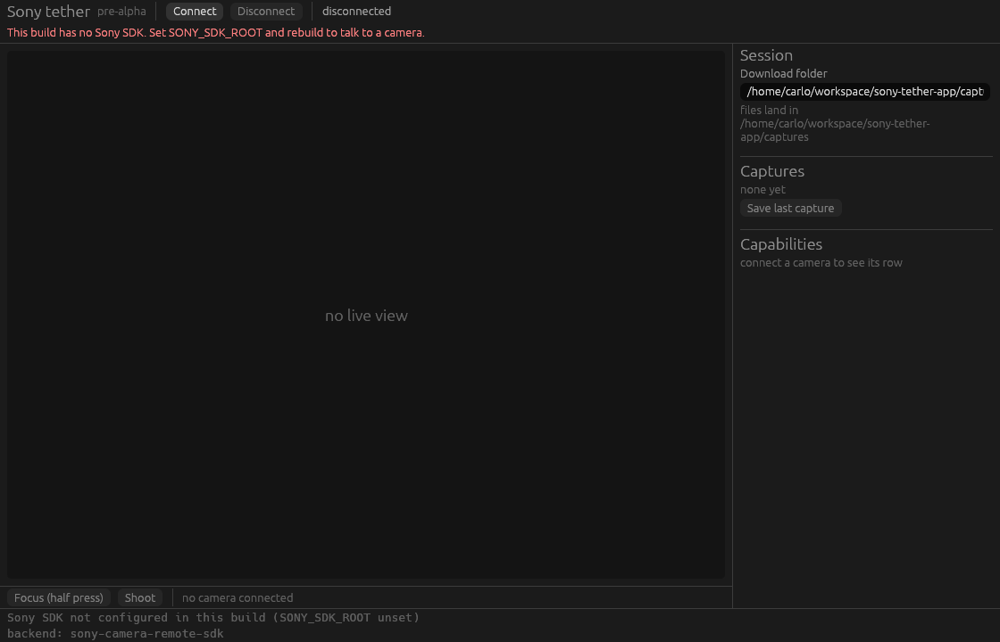

# Sony tether app

A desktop app that tethers a Sony A7 camera over USB: live view, shutter release, and every capture saved straight to a folder on the computer.

**Status: pre-alpha skeleton.** The window opens, the wiring exists, and the camera backend answers "no SDK configured". Live view, shutter and download arrive in milestone M2. See [PLAN.md](PLAN.md).



That is the real window, not a mock-up. This machine has no Sony SDK, so the banner and the disabled shutter are the honest state: the app knows what it is missing and says so.

## Target

- Camera: Sony A7 IV (`ILCE-7M4`), firmware 6.02.
- Platform: Windows 10/11, x64.
- Camera control: [Sony Camera Remote SDK](https://developer.sony.com/develop/cameras/), which you must obtain yourself.

## Before it can talk to a camera

Two things are outside this repository.

1. **Sony's SDK.** Register as a Sony developer, accept their licence, and download the Camera Remote SDK. You need the Windows x64 build.
2. **A camera in the right mode.** Set the A7 IV's USB connection to PC Remote. Do not use USB Streaming.

Then point the build at the SDK:

```powershell
setx SONY_SDK_ROOT "C:\path\to\extracted\CrSDK"
```

At runtime the app looks for a directory containing `manifest.json` and the shim, in this order: `TETHER_SDK_DIR`, then `sdk/` beside the exe, then `sdk/` in the working directory. See [docs/sdk-layout.md](docs/sdk-layout.md).

Without that variable the build still succeeds, but it compiles a stub backend that reports "SDK not configured". **Never ship a release built that way.**

## Build

Install Rust with [rustup](https://rustup.rs), using the MSVC toolchain and the Visual Studio C++ build tools:

```powershell
rustup default stable-msvc
cargo build --release
cargo test
cargo run -p tether-app
```

The binary is `target\release\tether-app.exe`.

## Release build

```powershell
cargo xtask release
```

This builds in release mode and writes a zip to `dist/`, prints its SHA-256, and adds a `BUILD-INFO.txt` stating whether the build can tether.

| What you want | Command |
|---|---|
| A build that can drive a camera | `cargo xtask release` with `SONY_SDK_ROOT` set |
| The same, with Sony's libraries inside the zip | add `--bundle-sdk $env:SONY_SDK_ROOT` |
| A packaging test with no SDK | `cargo xtask release --allow-stub` |

Without `SONY_SDK_ROOT` the tool refuses to package, so a build that cannot tether cannot be published by accident. `--allow-stub` overrides that, and the artifact is then named `...-stub` with the warning in its `BUILD-INFO.txt`.

Whether you may put Sony's libraries in the zip is Sony's decision. If you are unsure, ship without `--bundle-sdk`; users then point `TETHER_SDK_DIR` at their own SDK. See [docs/sdk-layout.md](docs/sdk-layout.md).

## Publishing a release

Releases are cut by hand:

```powershell
gh workflow run release.yml -f build=sdk -f tag=v0.2.0 -f publish=true
```

- `build=sdk` publishes a normal release, and needs the self-hosted runner.
- `build=stub` publishes a **pre-release** whose title says it cannot tether. Use it to share the interface, never to represent a working build.
- Leave `tag` empty to upload a workflow artifact without creating a release.

Both paths run the tests first, so a red build cannot reach the release page.

## Layout

| Path | What it is |
|---|---|
| `apps/tether-app` | The egui window. UI only |
| `apps/tether-app/src/review.rs` | The Last capture tab: decode one file, keep it in a texture |
| `crates/camera-core` | Backend trait, event types, session and filename rules, capability matrix. No vendor code |
| `crates/backend-sdk` | The only crate that touches Sony's SDK. C++ shim lives in `native/` |
| `crates/camera-core/data/cameras.json` | The capability matrix: what is known per body, per feature |
| `docs/sdk-layout.md` | How the app finds Sony's SDK at runtime, and why |

Read [PLAN.md](PLAN.md) for scope, acceptance criteria, milestones and risks.

## Continuous integration

`.github/workflows/ci.yml` builds and tests the Windows path on every push, with the Sony SDK deliberately absent. It proves compilation and unit tests on MSVC. It cannot prove tethering: that needs a camera on a desk, or a self-hosted runner on your own PC.

## Licence

MIT for this project's code. Sony's SDK is not covered by it and is never committed here. See [CONTRIBUTING.md](CONTRIBUTING.md).

This project is not affiliated with Sony. "Sony" and "Alpha" are trademarks of Sony Group Corporation.